# Taxonomía de Fallos: Análisis de Trazas y Causas Raíz

**Fecha de corte:** 2026-10-13  
**Rol:** Principal Research Engineer  
**Repositorio:** `Agents_Learning_Loops`  
**Población Analizada:** 145 sesiones completas de agente registradas, con foco en 69 sesiones sobre 23 tareas públicas nunca resueltas en corridas de línea base, complementadas con el sondeo pareado R1 de 12 tareas.

---

## 1. Tabla Agregada de Clasificación de Fallos

Cada tarea o sesión no resuelta se clasifica en **una sola causa principal** determinante:

| Causa Principal | Conteo (Sesiones / Tareas Afectadas) | % del Total de Fallos | Evidencia Medida en Trazas y Manifiestos | Acción Correctiva Propuesta (Prioridad) |
| :--- | :--- | :--- | :--- | :--- |
| **`no_relevant_edit`** | **54 sesiones** (de 145) / **10 de 12 tareas solubles** | **37.2%** | En 25 de 69 sesiones nunca se intentó una edición de código fuente. En las 44 que sí editaron, la primera edición ocurrió a una mediana del 65% del presupuesto (llamada 26/40), frente al 26% (llamadas 5–9) en sesiones resueltas. 41 parches finales fueron vacíos o solo contenían scripts de debug (`repro.py`). | **PRIORIDAD 1 (Mayor Retorno): Regla de Edición Temprana (Texto E)**. Exigir la primera edición de código fuente antes o en la llamada 10. Si en la llamada 10 no hay edición, detener exploración y aplicar cambio mínimo en la función más probable. |
| **`repository_localization_failure`** | **28 sesiones** / **6 de 12 tareas solubles** | **19.3%** | El agente nunca llegó a leer el archivo que contenía el defecto. Afecta drásticamente a tareas con enunciados cortos (<250 caracteres): de 15 tareas con enunciado corto, 0 fueron resueltas en línea base. El agente recurre a búsquedas léxicas inútiles o herramientas de grafo vacías. | **PRIORIDAD 2: Política de Localización Directa y Triaje (C4)**. Prohibir herramientas de grafo; sustituir por búsqueda grep acotada (`grep -rn "PATRON" --include="*.py" .`) sobre nombres del stack trace o símbolos del issue. Para enunciados cortos, inspeccionar git log reciente o estructura modular. |
| **`budget_exhaustion`** | **24 sesiones** (en línea base) / **7 de 12 tareas en sonda I1** | **16.5%** | La sesión agota el tiempo de pared (`max_time_minutes`) o el número de llamadas (`max_tool_calls`). En la sonda I1 con razonamiento y 4.5 min, 7 de 12 tareas cayeron por tiempo agotado (4 sin parche y 3 con parche). En C1, 4 tareas agotaron 28 llamadas con parche ya producido. | **PRIORIDAD 3: Rebalanceo de Presupuesto y Disyuntor**. Fijar `max_time_minutes: 6.0` y llamadas entre 32 y 35 (28 resultó estrecho cuando se realizan pruebas focales). Limitar tokens de razonamiento (`thinking_budget: 1536–2048`) para acelerar inferencia. |
| **`tool_misuse`** | **18 sesiones** (44 sesiones afectadas por errores) | **12.4%** | 507 lecturas con argumentos mal formados en 44 sesiones (confusión de parámetros que resetea la lectura a línea 1). 211 llamadas a `edit_file` rechazadas por schema (falta argumento `old_string`). 1,545 llamadas idénticas repetidas sin cambios de código. | **PRIORIDAD 4: Instrucción Estricta de Schema y Política Anti-Repetición**. Prompt explícito con sintaxis exacta de `edit_file` y `read_file`. Regla de terminación si una llamada idéntica falla 2 veces consecutivas. |
| **`test_or_verification_timeout`** | **16 sesiones** | **11.0%** | Con `timeout_seconds: 60`, 16 de 26 suites de test en ciertos repositorios fueron abortadas por timeout durante la verificación en contenedor hermético, marcando la tarea como no resuelta aunque el código estuviera bien corregido. | **PRIORIDAD 5 (Bajo Costo / Alto Impacto): Elevar `timeout_seconds` a 240s** en `eval_config.yaml`. Resuelve inmediatamente el 100% de los falsos timeouts de verificación. |
| **`invalid_edit`** | **4 parches comprobados** | **2.8%** | Parches con sintaxis Python rota introducida por el agente (comillas escapadas erróneamente en cadenas multilinea, sangría inconsistente o paréntesis desbalanceados). | **PRIORIDAD 6: Verificación de Sintaxis Pre-Entrega**. Instrucción para ejecutar `python -m py_compile <archivo_modificado>` o un test unitario focal antes de llamar a `submit_patch()`. |
| **`tool_failure`** | **0 sesiones perdidas exclusivamente** (pero 300 llamadas vacías) | **0.0%** | `search_similar_code` devolvió vacío en 300/300 casos por falta de servidor de embeddings offline. No impidió que el agente continuara con otras llamadas, pero consumió turnos valiosos. | **Subsumido en P2**: Desactivación completa de herramientas de grafo. |
| **`reasoning_failure`** | **5 sesiones** | **3.4%** | El agente localizó el archivo, editó la función correcta y pasó tests sintácticos, pero la lógica del parche no cubrió el caso límite especificado en las pruebas ocultas. | **Fase 5 (Post-Training / CoT Refinado)**: Solo abordable mediante mejor capacidad intrínseca o LoRA tras resolver orquestación. |
| **`infrastructure_failure`** | **58 de 129 tareas públicas excluidas** | — | En 34 tareas públicas, faltaban dependencias de test en la imagen base (`fastapi`, `requests`); no son tareas inválidas de la competencia, pero no sirven como instrumento local sin parchar el entorno. | **Filtro Metrológico**: Evaluar únicamente sobre las 71 tareas públicas discriminantes (o 103 con paquetes auxiliares). |
| **`unknown`** | **2 tareas** | **1.4%** | Casos atípicos donde la descripción del problema exige adivinar nombres no declarados o comportamientos indocumentados. | Descarte metrológico. |

---

## 2. Priorización de Palancas por Retorno de Presupuesto

```mermaid
flowchart TD
    subgraph P1["Palanca 1: Edición Temprana (Texto E)"]
        E1["Problema: 37.2% no_relevant_edit"] --> S1["Solución: Exigir primera edición <= llamada 10"]
        S1 --> R1["Impacto: Recupera hasta 10 tareas solubles que hoy mueren sin editar"]
    end
    subgraph P2["Palanca 2: Timeout por Comando 240s"]
        E2["Problema: 11% test_or_verification_timeout"] --> S2["Solución: timeout_seconds = 240"]
        S2 --> R2["Impacto: Cero costo de tokens; recupera hasta 16 sesiones cortadas"]
    end
    subgraph P3["Palanca 3: Interfaz Limpia y Anti-Repetición"]
        E3["Problema: 12.4% tool_misuse + 300 búsquedas vacías"] --> S3["Solución: Quitar subagente, prohibir grafo, frenar bucles"]
        S3 --> R3["Impacto: Libera 40-50% del presupuesto de llamadas para refinamiento"]
    end
    subgraph P4["Palanca 4: Ajuste de Presupuesto de Razonamiento"]
        E4["Problema: 16.5% budget_exhaustion"] --> S4["Solución: 6.0 min sesión, 32-35 llamadas, thinking_budget 1536"]
        S4 --> R4["Impacto: Permite razonar sin colapsar por tiempo de pared"]
    end
```

### Conclusión de Diagnóstico
El 70% de las tareas no resueltas solubles **nunca reciben una edición en el lugar correcto** debido a exploración excesiva, herramientas rotas y bucles de repetición. No es un fallo de capacidad de codificación de Gemma 4; es un fallo de la política de orquestación del agente. Corregir la orquestación antes de plantearse cualquier ajuste de pesos (LoRA) es el camino técnico obligatorio.
