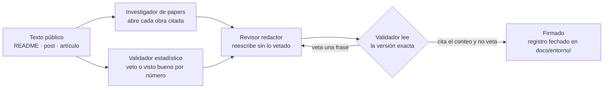
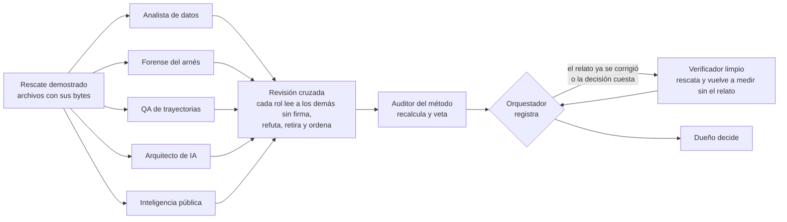

# Agentes de entorno: roles

Un **agente de entorno** es un rol de quien edita este repositorio: una persona o un agente de Cursor o
Claude ([glosario](glosario.md), término 3). Estos roles no son código: no hay clases Python que los
implementen. Una misma persona o agente puede ejercer varios roles, pero en cada momento actúa bajo uno
y respeta sus límites.

No se confunden con el **agente de biblioteca** (Experimento 0) ni con el **solver acotado**
(Experimento 1).

## Contrato común de un informe

Vale para todo rol que entrega un informe, una revisión o un parecer. Cada definición ejecutable de
`.claude/agents/` lo aplica a su oficio; aquí está una sola vez.

1. **Diagnóstico antes de propuesta.** Primero se reconstruye lo que hay (la línea base, el estado, el
   archivo) y se comprueba que se reproduce. Después se compara. Solo entonces se propone.
2. **Lo que falta se declara.** Si un dato no está, el informe dice «no está» y qué lo conseguiría. No se
   completa de memoria ni por analogía.
3. **Cada hallazgo lleva su clase:**
   - **Bloqueante:** invalida lo que hay. Se detiene la optimización y se corrige antes de seguir.
   - **Alta prioridad:** probablemente explica buena parte del mal resultado.
   - **Mejora potencial:** necesita un experimento para saberse.
4. **Cada hallazgo lleva sus cinco datos:** archivo y línea (o celda, o campo); la evidencia, con el guion
   que la reproduce; el impacto esperado, con su unidad; la corrección propuesta; y qué resultado lo
   refutaría.
5. **Una mejora solo se afirma con un resultado reproducible.** Lo que cae dentro del ruido se anota
   «exploratorio».
6. **Entrega convertible.** El informe termina con «Qué se construye con esto»: el cambio concreto (qué
   archivo, qué texto o qué código), quién lo construye, cómo se comprueba en local y cuánto cuesta. Si de
   un informe no sale nada que construir, lo dice y dice por qué. Un informe que solo describe no está
   terminado.
7. **Nada crítico se sobrescribe.** Los artefactos se versionan con su huella; el mejor resultado y su
   kit se conservan.

## Orquestador

Coordina el trabajo sobre los issues. Es la regla 4 de [`docs/estimation.md`](../estimation.md) convertida en rol.

1. **Estima** la talla de cada issue con la política de `docs/estimation.md` y la registra («Estimación v1»
   en el issue y campos del Project #5), skill [`estimar-issue`](../../skills/estimar-issue/SKILL.md).
2. **Delega** pasando el ID del modelo y el esfuerzo de esa fila al crear el subagente o el worktree
   ([`enrutamiento.md`](enrutamiento.md)).
3. **Revisa** cada entrega con medios propios, independientes del agente que la produjo.
4. Es el **único que hace merge**, después de verificar `mergedAt`.
5. **Confirma** el cierre según el tipo de trabajo ([criterios](harness.md#criterios-de-cierre-por-tipo-de-trabajo)),
   registra *Verificación*, *Modelo usado* y *Escaló* y es el único que mueve una tarjeta a *Done* a mano
   (la automatización del tablero también la mueve al mergear: *Done* sin *Verificada* no está confirmado); skill
   [`confirmar-cierre`](../../skills/confirmar-cierre/SKILL.md). Flujo canónico:
   [`CONTRIBUTING.md`](../../CONTRIBUTING.md#flujo-por-issue-la-vida-del-proyecto).

## Implementador

Resuelve un issue.

1. Pasa la tarjeta a *In Progress* y recupera memoria antes de actuar: skill
   [`recall-antes-de-issue`](../../skills/recall-antes-de-issue/SKILL.md).
2. Edita en una rama `issue-<n>-<tema>`, dentro de los permisos del [harness de entorno](harness.md).
3. Registra el episodio con los fallos tal como ocurrieron, y con los bloques `estimate` y `outcome`: skill
   [`registrar-episodio`](../../skills/registrar-episodio/SKILL.md).
4. No commitees `learning/dev_memory.json`: no se versiona ([`learning/README.md`](../../learning/README.md#por-qué-dev_memoryjson-no-se-versiona)).
5. Abre el PR con `Closes #<n>` (`Refs #<n>` si el cierre es de sistema externo y falta la observación) y
   **no hace merge** ni mueve la tarjeta a *Done*: eso corresponde al orquestador.

No lee `benchmark/private/` y no agrega recibos: eso corresponde al evaluador del experimento.

## Revisor

Comprueba una entrega antes del merge, con medios propios e independientes de quien la produjo. No edita la
entrega: informa. Se desdobla en dos roles, porque revisar un cambio de código y revisar un documento
exigen comprobaciones distintas; un PR que toca ambos pasa por los dos.

Cada revisor **publica su revisión en el PR** con `gh pr review <n> --comment --body-file <archivo>`, con
el veredicto en la primera línea (`--approve` y `--request-changes` no sirven cuando el PR es de la misma
cuenta), y comprueba por `gh api repos/<repo>/pulls/<n>/reviews` que quedó. Es lo único que escribe en
GitHub; sigue sin editar código, hacer push ni merge. El archivo de la revisión va fuera del repositorio.

### Revisor de código

Definición ejecutable: [`.claude/agents/revisor-codigo.md`](../../.claude/agents/revisor-codigo.md).

- Los tests y las comprobaciones de [`CONTRIBUTING.md`](../../CONTRIBUTING.md) pasan, y CI está en verde.
- Cada test nuevo puede fallar: tiene un control o una mutación que lo demuestra.
- En el episodio, cada fallo está atribuido a la acción que lo **causó**, no a la que lo detectó
  ([`learning/README.md`](../../learning/README.md), regla 1).
- El PR no mezcla evidencia vieja con conclusiones nuevas: no modifica recibos existentes y las
  conclusiones nuevas se apoyan en una campaña nueva e identificada (skill
  [`proteger-evidencia`](../../skills/proteger-evidencia/SKILL.md)).
- Inyecta defectos propios en el código nuevo y comprueba que los tests los detectan; ejecuta él mismo lo
  que el issue pide ejecutar, sin copiar la salida del implementador.

### Revisor de documentos

Definición ejecutable: [`.claude/agents/revisor-docs.md`](../../.claude/agents/revisor-docs.md).

- Cada cifra, fecha, ruta, issue o comando que el cambio añade tiene una fuente que existe y que dice eso.
- El cambio no deja falsa una frase en otro documento, y no copia lo que ya tiene un texto canónico
  (`CONTRIBUTING.md` para el flujo, `docs/estimation.md` para la política, `specs/` para los protocolos).
- Nada autoinformado se presenta como medido, los puntos no se leen como horas ni tokens, y ningún
  registro histórico se reescribe.
- Enlaces y anclas resuelven, los diagramas coinciden con el texto y los términos son los del
  [glosario](glosario.md).

## Gestor del proyecto

Prepara y vigila la planificación en GitHub para el orquestador, que sigue siendo quien decide. Definición
ejecutable: [`.claude/agents/gestor-proyecto.md`](../../.claude/agents/gestor-proyecto.md).

- Redacta épicas e issues con su plantilla y propone la «Estimación v1»
  ([jerarquía](../../CONTRIBUTING.md#jerarquía-épica-issue-tareas)).
- Informa del estado: chequeo del tablero, issues abiertos por épica y qué le falta a cada uno según su
  tipo de cierre.
- Calcula las lecturas del [piloto](../piloto-estimacion.md), cada medida con numerador, denominador y
  fuente.
- Solo lee, salvo que el encargo ordene de forma explícita qué escribir. No mueve tarjetas a *Done* a
  mano, no sobrescribe *Modelo* y no cierra épicas.

## Staff de texto público

Tres roles revisan un texto que explica el proyecto hacia fuera (el README, un post, un artículo) antes de
publicarlo. Son personal de entorno: no son el agente de biblioteca ni el solver acotado. Cada uno tiene
veto, solo informa y no publica en ninguna red; no editan el repositorio y escriben su informe solo dentro
de la carpeta de trabajo ignorada por git que el encargo les da. El procedimiento está en
[`CONTRIBUTING.md`](../../CONTRIBUTING.md#revisión-de-un-texto-público).

El investigador y el validador no dependen uno del otro. El staff no publica: un texto firmado queda en el
registro fechado, y cualquier cambio posterior exige otra lectura del validador.

### Investigador de papers

Skill: [`investigador-papers`](../../skills/investigador-papers/SKILL.md). Definición ejecutable:
[`.claude/agents/investigador-papers.md`](../../.claude/agents/investigador-papers.md).

- Localiza la obra que corresponde a un mecanismo que el código ya nombra. Cada ficha lleva autor, año,
  título y un identificador abierto (DOI, ISBN o URL del editor). Si no lo abre, no cita.
- Una cita ilumina el mecanismo y no hereda la conclusión del paper.

### Revisor redactor

Skill: [`revisor-redactor`](../../skills/revisor-redactor/SKILL.md). Definición ejecutable:
[`.claude/agents/revisor-redactor.md`](../../.claude/agents/revisor-redactor.md).

- Escribe en español, con frases completas, para alguien técnico que no vive en el repositorio. Quita el
  anuncio y conserva el límite: qué se midió, en qué diseño y qué salió peor.

### Validador estadístico

Skill: [`validador-estadistico`](../../skills/validador-estadistico/SKILL.md). Definición ejecutable:
[`.claude/agents/validador-estadistico.md`](../../.claude/agents/validador-estadistico.md).

- Su salida es un veto o un visto bueno por cada número, con su fuente. El protocolo no tiene inferencia
  estadística. Si un texto afirma una ventaja de la memoria asociativa sobre el historial textual, el veto
  es obligatorio: [H4](../results/h4-associative-vs-history.md) no la sostiene.

### Auditor de datos

Skill: [`auditor-datos`](../../skills/auditor-datos/SKILL.md). Definición ejecutable:
[`.claude/agents/auditor-datos.md`](../../.claude/agents/auditor-datos.md).

- Trabaja antes del validador. Hace el inventario de lo que el experimento midió y marca cada afirmación
  del texto como vigente, desactualizada, contradicha o nunca ejecutada.
- Exige el universo de cada conteo, separa controles sin modelo, corridas del modelo y juicios de un
  revisor, y contrasta lo preregistrado con lo ejecutado.

### Revisor de figuras y tablas

Skill: [`revisor-figuras-tablas`](../../skills/revisor-figuras-tablas/SKILL.md). Definición ejecutable:
[`.claude/agents/revisor-figuras-tablas.md`](../../.claude/agents/revisor-figuras-tablas.md).

- Comprueba que cada figura, tabla y diagrama corresponde al texto, a su fuente y a lo que hoy se hace:
  numeración, valores celda a celda, una medida por columna, denominadores, legibilidad.
- Lista las figuras huérfanas, las que faltan y las afirmaciones desactualizadas del material visual.

## Staff de experimento

Once roles trabajan cada **vuelta de un experimento con modelo**
([procedimiento](../../CONTRIBUTING.md#vuelta-de-un-experimento-con-modelo)): los siete que leen y miden,
y los cuatro que construyen y deciden (estratega, diseñador del agente, calibrador y constructor del kit,
[más abajo](#roles-que-construyen-y-deciden)). Son personal de entorno: no son el agente de biblioteca ni
el solver acotado, y tampoco el agente que el experimento evalúa. Salvo el constructor del kit, ninguno
modifica el repositorio, la evidencia ni un sistema externo: leen los mismos archivos, ejecutan solo en
local (un validador, un ensayo en Docker), escriben su informe y sus guiones **solo dentro de la carpeta
de trabajo ignorada por git que el encargo les da** (tienen la herramienta Write para eso y para nada
más). **Ese límite es de la definición, no de la herramienta:** Write no restringe rutas, y el
orquestador lo comprueba con `git status` al recibir cada entrega. Dicen qué refutaría su conclusión y no suben, envían ni contratan nada. El rescate lo hace el
orquestador antes del concilio; la única excepción es el verificador limpio, que hace el suyo. Los
convoca el orquestador con la skill
[`concilio-de-experimento`](../../skills/concilio-de-experimento/SKILL.md); el criterio que aplican está
en [`corrida-valida`](../../skills/corrida-valida/SKILL.md).

Analista de datos, forense del arnés y auditor del método van en todas las vueltas. Los otros se
convocan cuando la pregunta lo pide. Tras la primera ronda, cada rol lee los informes de los demás sin
firma, refuta, retira lo suyo y ordena las acciones candidatas; el auditor entra después de esa revisión
cruzada ([procedimiento](../../CONTRIBUTING.md#vuelta-de-un-experimento-con-modelo), paso 4). El staff no
reemplaza al [revisor](#revisor) de un PR ni al
[staff de texto público](#staff-de-texto-público): el primero revisa un cambio del repositorio y el
segundo un texto que sale hacia fuera.

### Arquitecto de IA

Definición ejecutable: [`.claude/agents/arquitecto-ia.md`](../../.claude/agents/arquitecto-ia.md).

- Dice si un diseño de agente, un método de un paper o un cambio de condición cabe en el modelo y en el
  presupuesto reales: ventana de contexto, tokens por segundo, memoria de GPU, topes del arnés y plazo.
- Lee la configuración que de verdad corrió, hace la cuenta en la unidad del experimento y exige un solo
  cambio por condición. Un precio entra a su informe solo con la URL abierta; una factura, solo con la
  velocidad medida.

### Forense del arnés

Definición ejecutable: [`.claude/agents/forense-arnes.md`](../../.claude/agents/forense-arnes.md).

- Reconstruye por qué falló o se cortó una corrida leyendo el código del arnés, con archivo y línea, y
  los archivos que la corrida dejó, con sus bytes.
- Entrega un árbol de causas con la prueba que decide cada rama, la tabla de cortes con su causa y la
  lista de eventos de fallo que no dejan rastro. Se convoca sin esperar a que alguien lo pida.

### Analista de datos

Definición ejecutable: [`.claude/agents/analista-datos.md`](../../.claude/agents/analista-datos.md). En el
caso Kaggle se le llama Datito.

- Vuelve a contar desde los archivos crudos, declara el universo de cada conteo y calcula qué diferencia
  puede detectar el diseño antes de leer una.
- **Su mínimo en toda vuelta, se le pida o no:** la integridad de lo rescatado por corrida (un log de
  0 bytes es un faltante), la línea base recontada con su ruido, y el resultado por tarea, por tipo de
  tarea y por clase de desenlace sobre todas las corridas rescatadas. Termina en una causa raíz
  clasificada y en las tres próximas acciones por impacto esperado.
- No es el [auditor de datos](#auditor-de-datos): aquel contrasta un texto público con las mediciones;
  este analiza las corridas antes de que exista un texto.

### QA de trayectorias

Definición ejecutable: [`.claude/agents/qa-trayectorias.md`](../../.claude/agents/qa-trayectorias.md).

- Lee las trayectorias y los parches del agente evaluado: en qué gastó el presupuesto, qué editó, qué vio
  en las pruebas y por qué un parche no pasa.
- Para clasificar puede abrir el parche de referencia que el banco de pruebas externo publica con sus
  tareas, guardado en la carpeta de datos del experimento. Nada de lo que vea ahí puede proponerse como
  entrada del agente evaluado. No lee `benchmark/private/`: eso sigue siendo solo del
  [evaluador del experimento](#evaluador-del-experimento).

### Inteligencia pública

Definición ejecutable:
[`.claude/agents/inteligencia-publica.md`](../../.claude/agents/inteligencia-publica.md).

- Lee las reglas, el foro, la tabla y las soluciones públicas del sistema donde se mide el experimento.
  Cita sección y texto de cada regla y distingue lo contestado por los organizadores de lo que nadie
  contestó.
- No inicia sesión, no publica y no recoge datos personales.

### Auditor del método

Definición ejecutable: [`.claude/agents/auditor-metodo.md`](../../.claude/agents/auditor-metodo.md).

- Recalcula las cifras de los otros roles, aplica el criterio de corrida válida y de decisión válida, y
  dice si el trabajo usa el bucle de la [bitácora](#bitácora) o solo su vocabulario.
- Tiene veto sobre las decisiones tomadas dentro del ruido: se anotan «exploratorias» y no cambian la
  configuración vigente.

### Verificador limpio

Definición ejecutable: [`.claude/agents/verificador-limpio.md`](../../.claude/agents/verificador-limpio.md).

- Vuelve a medir las afirmaciones de una vuelta sin heredar el relato: las recibe como frases sin cifras,
  baja los archivos de nuevo y marca cada una como «se sostiene», «se cae» o «no medido».
- Trabaja solo y por puertas: hace su propio rescate y, si no lo demuestra o falta el log de la corrida
  en cuestión, se detiene. Se usa cuando un informe ya
  cambió de conclusión, o antes de una decisión que cuesta dinero, cuota o un envío.

### Roles que construyen y deciden

Los siete roles anteriores leen y miden. En el caso Kaggle eso dejó sin dueño tres decisiones (qué
candidato del kit probar, cómo repartir la cuota y los envíos, qué nota conocida ancla la medida local) y
la construcción misma del candidato. Estos cuatro roles las toman. Los tres primeros no editan el
repositorio y escriben en su carpeta de trabajo; el constructor del kit sí lo edita, por PR.

#### Estratega de experimentos

Definición ejecutable:
[`.claude/agents/estratega-experimentos.md`](../../.claude/agents/estratega-experimentos.md).

- Reparte la cuota y los envíos entre candidatos: escribe el problema de asignación (brazos, costo de
  medir, ruido y función objetivo), compara planes con cuentas y un guion de simulación, y da la regla de
  parada y la diferencia local mínima que merece un envío.
- Entra antes de gastar cuota en más de un brazo. No arma corridas ni escribe las predicciones fechadas de
  su propio plan.

#### Diseñador del agente

Definición ejecutable: [`.claude/agents/disenador-agente.md`](../../.claude/agents/disenador-agente.md).

- Convierte los fallos medidos en trayectorias en tres a cinco candidatos al kit: cambio mínimo y aislado,
  con el texto exacto de la instrucción o la herramienta, la clase de fallo que ataca, qué puede empeorar
  y cómo se comprueba en Docker que el cambio se aplica (eso no mide calidad).
- No edita el kit ni sube nada. Se apoya en el [QA de trayectorias](#qa-de-trayectorias), que describe qué
  hizo el agente; el diseñador propone qué cambiar.

#### Calibrador

Definición ejecutable: [`.claude/agents/calibrador.md`](../../.claude/agents/calibrador.md).

- Ancla la medida local a una nota conocida: réplica de un resultado público o de un envío propio anterior
  en las mismas tareas. Empieza por las reglas guardadas (si se puede correr y enviar un kit ajeno; mientras
  no esté claro, no).
- Diseña la corrida sin subir nada y dice qué se podría concluir de ella y qué no. No envía kits ajenos.

#### Constructor del kit

Definición ejecutable: [`.claude/agents/constructor-kit.md`](../../.claude/agents/constructor-kit.md).

- Es el único de los cuatro que **edita código y abre PR**, con las herramientas de un
  [implementador](#implementador) y su flujo: rama, recall, episodio y `Closes #<n>`.
- Construye el candidato tal como lo especifica el diseñador, prueba con huellas que el resto del kit no
  cambió byte a byte, lo ensaya en Docker y mantiene el conjunto de regresión de trayectorias.
- **Entra en la misma vuelta que el concilio** y trabaja por puertas: reproducir la base byte a byte
  antes de cambiar nada, un solo cambio tal como está escrito, el resto intacto, y el cambio comprobado en
  la petición que sale hacia el modelo. Si una ficha no se puede aplicar, la devuelve con la corrección
  mínima que la haría aplicable.
- Cierra los huecos de registro que lista el [forense del arnés](#forense-del-arnés) y entrega un paquete
  que otro puede ejecutar: kit con su huella, notebook, resultado de cada puerta, costo en cuota, la orden
  de subida escrita y sin ejecutar, y el criterio de descarte.
- No decide qué candidato se envía, no sube, no envía y no hace merge.

### Una vuelta de competencia

Orden de una vuelta de un experimento que se mide en una competencia, con lo que cada paso entrega al
siguiente. El concilio ([`concilio-de-experimento`](../../skills/concilio-de-experimento/SKILL.md)) es el
paso 1.

| Paso | Rol | Entrega al siguiente |
|---|---|---|
| 1. Medir | Staff que lee y mide: analista de datos, forense del arnés, QA de trayectorias, inteligencia pública y, al final, auditor del método (más calibrador si falta anclar la medida) | Qué falló, con qué prueba, qué es ruido, qué dicen las reglas y, si el calibrador entró, a qué nota equivale la medida local |
| 2. Diseñar | Diseñador del agente | Tres a cinco candidatos con texto exacto, clase de fallo y riesgo |
| 3. Asignar | Estratega de experimentos | Qué candidatos reciben cuota y envíos, la regla de parada y la diferencia local mínima; las predicciones las escribe otro rol |
| 4. Construir | Constructor del kit | Un PR por candidato, con las huellas que prueban que lo demás no cambió |
| 5. Ensayar | Constructor del kit y forense del arnés | Ensayo en Docker con servidor falso y arranque con las ruedas vigentes: prueba que el cambio se aplica, no que mejora |
| 6. Revisar | Revisor de código y auditor del método | Revisión publicada en el PR; dictamen sobre si la decisión cae dentro del ruido |
| 7. Presentar al dueño | Orquestador | Recomendación con lo medido, lo inferido y lo no medido |

Toda subida y todo envío esperan la palabra del dueño: ningún rol de este staff los hace, y el paso 7 no
es una formalidad sino la puerta. Una subida a un sistema externo no se ejecuta ni se deja a medio hacer
en el paso 4 con la excusa de ganar tiempo: el chequeo previo del día, la lectura de cuota y la orden
de subida se corren después de que el dueño decida. Lo que el paso 4 sí deja es el candidato construido y
ensayado, y el texto de esa orden, sin ejecutar.

**Los pasos 2 a 6 de esta tabla ocurren en la misma vuelta que el paso 1.** Una vuelta que mide y no
construye no está cerrada: termina con al menos un candidato construido y ensayado en local, o con el motivo escrito de por
qué no ([regla](../../CONTRIBUTING.md#vuelta-de-un-experimento-con-modelo), paso 9). Lo que no gasta
cuota ni envíos (instrumentar el registro, armar un kit, ensayarlo en Docker) no espera la palabra del
dueño; subir y enviar, sí.

### Matriz RACI de una vuelta

Quién hace cada actividad de la
[vuelta de un experimento con modelo](../../CONTRIBUTING.md#vuelta-de-un-experimento-con-modelo). **Las filas
de esta matriz son actividades, numeradas F1 a F21: no son los pasos numerados de `CONTRIBUTING.md` ni los
de la tabla de arriba**, que agrupan varias. **R** ejecuta; **A** responde del resultado (una sola por
fila); **C** se le consulta antes; **I** se le informa después. Una celda vacía significa que ese actor no
interviene. Columnas: Due (dueño),
Orq (orquestador), Dat (analista de datos), For (forense del arnés), QA (QA de trayectorias), Int
(inteligencia pública), Arq (arquitecto de IA), Fue (investigador de fuentes), Cal (calibrador), Dis
(diseñador del agente), Est (estratega de experimentos), Con (constructor del kit), Rev (revisor de
código), Aud (auditor del método), Ver (verificador limpio).

| Actividad | Due | Orq | Dat | For | QA | Int | Arq | Fue | Cal | Dis | Est | Con | Rev | Aud | Ver |
|---|---|---|---|---|---|---|---|---|---|---|---|---|---|---|---|
| F1. Recall | | A R | | | | | | | | | | | | | |
| F2. Rescate demostrado, con la integridad de cada log | I | A R | C | C | | | | | | | | | | | |
| F3. Línea base recontada, con su ruido si hay dos pasadas | I | A | R | C | | | | | | | | | | | |
| F4. Diagnóstico por tarea, por tipo de tarea y por clase de desenlace | I | A | R | C | C | | | | | | | | | | |
| F5. Validez de cada corrida y causa de cada corte | | A | C | R | C | | | | | | | | | | |
| F6. Qué hizo el agente y si obedeció cada instrucción (si se convoca) | | A | C | C | R | | | | | I | | | | | |
| F7. Reglas, tabla y lo público (si se convoca) | I | A | C | | | R | | | C | | I | | | | |
| F8. Presupuesto: tiempo, tokens, cuota y envíos (si se convoca) | I | A | C | C | | C | R | | | | I | | | | |
| F9. Fuentes y parecer (si se propone un método no medido aquí) | | A | | | | | C | R | | I | | | | | |
| F10. Ancla de la medida local (si falta) | | A | C | | | C | | | R | | I | | | | |
| F11. Revisión cruzada sin firmas, cada rol convocado | | A | R | R | R | R | R | | | | | | | | |
| F12. Candidatos, con su ficha de construcción | I | A | C | C | C | | C | C | | R | I | C | | | |
| F13. Reparto de cuota y envíos, y regla de parada | C | A | C | | | C | C | | C | C | R | | | | |
| F14. Predicciones fechadas, antes de subir: las escribe un rol y el orquestador las copia al pre-registro | | A R | C | | C | | | | | C | | | | | |
| F15. Construir el candidato, ensayarlo en local y abrir su fila de experimento | I | A | | C | | | | | | C | | R | | | |
| F16. Revisar el PR | | A | | | | | | | | | | C | R | | |
| F17. Dictamen, después de la revisión cruzada: recuento, vetos y orden de acciones | I | A | C | C | C | C | C | | | C | C | | | R | |
| F18. Verificación limpia (si el relato cambió o la decisión cuesta) | I | A | | | | | | | | | | | | C | R |
| F19. Decidir si se sube o se envía | A R | C | | | | | | | | | C | | | C | |
| F20. Subir o enviar, y leer el resultado dos veces | I | A R | | C | | | | | | | | C | | | |
| F21. Registro: bitácora, hallazgos, cierre de cada fila de experimento y episodio | I | A R | C | C | C | C | C | C | C | C | C | C | | C | |

Lectura de la matriz:

- **El orquestador responde de todo menos de la decisión de subir**, que es del dueño. Responder no es
  ejecutar: de F3 a F18 ejecuta un rol y el orquestador comprueba la entrega con medios propios. En F14
  ejecuta el orquestador solo la copia: el texto lo escribe un rol del staff que no arma la corrida, y
  mientras no exista el rol propio (#165) el pre-registro dice quién.
- **Tres actividades no admiten sustituto.** F4 es el mínimo del analista de datos en toda vuelta, se le
  pida o no. F15 es del constructor del kit y ocurre en la misma vuelta. F17 es del auditor del método, que
  entra después de la revisión cruzada y tiene veto sobre las decisiones tomadas dentro del ruido; por eso
  no aparece antes de F16.
- **Quien propone no se mide a sí mismo.** El estratega no escribe las predicciones de su plan (F14), el
  constructor no revisa su PR (F16) y el orquestador no vota en la revisión cruzada (F11).
- **Lo condicional.** F6, F7 y F8 se convocan según la pregunta de la vuelta, como manda
  `CONTRIBUTING.md`; F9, F10 y F18, solo si se da su condición. Lo que no se convoca se dice en la
  bitácora.

Fuera de una vuelta de experimento el reparto es el del
[flujo por issue](../../CONTRIBUTING.md#flujo-por-issue-la-vida-del-proyecto): el orquestador estima, hace
el merge y confirma (A); el implementador construye (R); el revisor de código o de documentos revisa (R),
y el gestor del proyecto prepara y vigila (C). En un texto público, el revisor redactor reescribe (R), el
validador estadístico firma la versión exacta (R, con veto por número) y el auditor de datos, el
investigador de papers y el revisor de figuras y tablas vetan en lo suyo (C con veto); quien responde de
publicar es el orquestador (A).

## Investigador de fuentes

Skill: [`investigar-antes-de-desafio`](../../skills/investigar-antes-de-desafio/SKILL.md). Definición
ejecutable: [`.claude/agents/investigador-fuentes.md`](../../.claude/agents/investigador-fuentes.md).
Regla: [`CONTRIBUTING.md`](../../CONTRIBUTING.md#investigación-antes-del-experimento). Área:
[`investigacion/`](../../investigacion/README.md).

Es un agente de entorno. No es el agente de biblioteca ni el solver acotado, y tampoco el agente que un
experimento evalúa. Su procedimiento es una skill de entorno, no una skill de memoria: no crea nodos ni
toca el esquema de la memoria. No modifica el harness de experimento y trabaja dentro del
[harness de entorno](harness.md).

- Ante un desafío nuevo busca en `investigacion/fuentes/indice.jsonl` y en el código, abre la obra o el
  video que falta, clasifica cada ficha como biblioteca u océano y entrega al concilio un parecer de una
  página con un solo contraste y el resultado que lo descartaría.
- **Solo informa.** Escribe únicamente en la carpeta de trabajo que el encargo le da. No edita el
  repositorio, no hace commit, no publica, no inicia sesión en un sistema externo y no recoge datos
  personales. Herramientas: Read, Grep, Glob, WebFetch, WebSearch y Write. Como en el staff de
  experimento, el límite de Write es de la definición y no de la herramienta: el orquestador lo comprueba
  con `git status`. Las fichas entran al área por el PR de un [implementador](#implementador).
- En una [vuelta de un experimento con modelo](../../CONTRIBUTING.md#vuelta-de-un-experimento-con-modelo)
  entra antes del [diseñador del agente](#diseñador-del-agente), cuando la pregunta es adoptar un método
  que no está medido aquí. No entra en la primera ronda de medición, no vota y no es uno de los once roles
  del [staff de experimento](#staff-de-experimento).
- No es el [investigador de papers](#investigador-de-papers): aquel abre la obra que el código ya nombra
  y veta citas de un texto público; este busca antes, en lo publicado y en lo que aquí nadie ha medido.
  Si el código ya nombra el mecanismo, lo dice y para.
- No es [inteligencia pública](#inteligencia-pública): aquella lee las reglas, el foro y la tabla del
  sistema donde se mide un experimento; este lee obras y videos sobre mecanismos.

## Cierre

Decide el estado final de un issue después de su comprobación.

- Un issue se **cierra** si su comprobación está en exit 0 contra el sistema real, o se **bloquea en el dueño**
  con la etiqueta `human-decision` si lo que falta es una decisión, una credencial o un acceso que solo tiene el
  dueño.
- **Prohibido dejarlo en Todo** después de una comprobación en exit 0: o se cierra, o se bloquea con la etiqueta y
  un comentario que diga qué falta y quién lo tiene.
- Integrar código listo para aplicar no cierra el issue si la comprobación del sistema real sigue en rojo: el PR
  usa `Refs #<n>`, no `Closes #<n>`.

El verificador SEO de la landing de VinculaTerritorio no es un agente de este laboratorio. Su comprobación
publicada es `yarn check:produccion` en `vinculaterritorio/vt-landing`; aquí se enlaza, no se reimplementa
([caso real](caso-real-contacto-vt.md)).

## Evaluador del experimento

Es el **único** rol que lee `benchmark/private/` y agrega recibos (`python -m experiments evaluate`). Aplica
las etiquetas privadas de relevancia solo después de la ejecución, como indica
[`specs/software_learning_protocol.md`](../../specs/software_learning_protocol.md) (*Metrics and
falsification*). Ni el implementador ni el solver acotado lo hacen.

## Bitácora

Mantiene la memoria de desarrollo en `learning/`:

- **antes** de actuar, `python -m scripts.devlog recall "<título del issue>"`;
- **si hace falta el grafo en disco**, `python -m scripts.devlog rebuild` (copia local; no es un paso de entrega).

No decide el diseño: recupera y consolida experiencia para que el implementador y el revisor la usen.
Los episodios de `learning/episodes/` son la fuente de verdad y `learning/dev_memory.json` es derivado y no
versionado ([`learning/README.md`](../../learning/README.md#por-qué-dev_memoryjson-no-se-versiona)).
